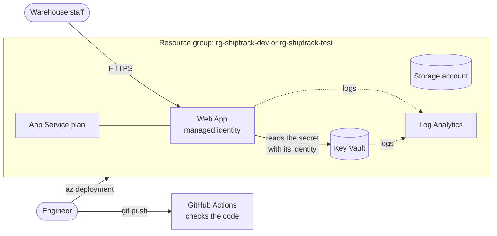

# ShipTrack – Infrastructure as Code (Bicep)

Builds Azure infrastructure for ShipTrack using Bicep, with Key Vault secrets via managed identity, GitHub Actions CI pipeline, secure storage and centralized monitoring.

This is my answer to the Nordvind Logistik case: replacing manual work in the Azure Portal with code that can be deployed again and again, the same way.

## How this solves Nordvind's problems

| Problem | Solution |
|---|---|
| Test and production are different, nobody knows which is right | One Bicep file deploys both environments. The only differences are written in two small parameter files. |
| Rebuilding takes a full day and depends on one person | One command rebuilds an environment in under one minute. The steps are written below. |
| Public blob access and a password in plain text | Storage is private and HTTPS only. The secret is in Key Vault, and the app reads it with its managed identity. No password in the code. |
| No record of who changed what | Every change is a Git commit (who, when, why). The pipeline checks the code. Logs go to Log Analytics. |

## What gets deployed

One resource group per environment: `rg-shiptrack-dev` and `rg-shiptrack-test`.

| Component | What | Important settings |
|---|---|---|
| Web hosting | App Service (Linux, B1) with a small "hello world" app | HTTPS only, managed identity |
| Secrets | Key Vault | Uses Azure RBAC |
| Access | Role "Key Vault Secrets User" for the web app | The app can only read secrets, nothing else |
| Storage | Storage account | Public blob access off, HTTPS only, TLS 1.2 minimum |
| Monitoring | Log Analytics workspace | Receives logs from the web app and Key Vault |
| Tags | On every resource | Environment, Owner, Application, CostCenter |

### Architecture



### How the app gets its secret

1. The web app has a managed identity: Azure gives it its own identity, so it does not need a password.
2. This identity has the role Key Vault Secrets User on the Key Vault. It can read secrets, and nothing else.
3. The app setting does not contain the secret. It contains a link to the secret in Key Vault.
4. When the app starts, Azure uses the identity to read the secret through this link.

## Why Bicep

- It is made by Microsoft for Azure, so it supports all Azure resources.
- It is short and easy to read, and VS Code helps with auto-completion.
- Nordvind only uses Azure, so a tool that works only with Azure is fine.

## Naming convention

Based on the Microsoft Cloud Adoption Framework: `<type>-<app>-<environment>-<suffix>`

| Resource | Example (dev) |
|---|---|
| Resource group | `rg-shiptrack-dev` |
| Log Analytics | `log-shiptrack-dev-vswhe` |
| Storage account | `stshiptrackdevvswhe` (no hyphens: Azure does not allow them here) |
| Key Vault | `kv-shiptrack-dev-vswhe` |
| App Service plan | `asp-shiptrack-dev-vswhe` |
| Web App | `app-shiptrack-dev-vswhe` |

The **suffix** (`vswhe`) is generated from the resource group. Some names must be unique in the whole world, and the suffix makes sure of that. It is always the same for the same resource group.

## Prerequisites

- **Azure CLI** and **Bicep** (`az bicep install`)
- **Git**
- **VS Code** with the Bicep extension (optional)
- An Azure account with the **Owner** role on the subscription (needed to give the role to the web app)

```powershell
az login
az account show
```

## How to deploy

Run the commands in PowerShell, from the root of the repository.

**1. Set the secret** (it stays on your computer, never in Git)

```powershell
$env:SHIPTRACK_SECRET = "<a demo value>"
```

**2. Deploy dev**

```powershell
az group create --name rg-shiptrack-dev --location swedencentral --tags Environment=dev Owner=infra-team Application=ShipTrack CostCenter=CC-1001
az deployment group create --resource-group rg-shiptrack-dev --parameters infra/params/dev.bicepparam
```

At the end, write down `webAppName` and `webAppUrl` from the `outputs`.

**3. Deploy the app**

```powershell
Compress-Archive -Path app\* -DestinationPath app.zip -Force
az webapp deploy --resource-group rg-shiptrack-dev --name <webAppName> --src-path app.zip --type zip
```

**4. Deploy test** (same commands, `test` instead of `dev`)

```powershell
az group create --name rg-shiptrack-test --location swedencentral --tags Environment=test Owner=infra-team Application=ShipTrack CostCenter=CC-1001
az deployment group create --resource-group rg-shiptrack-test --parameters infra/params/test.bicepparam
```

## How to test

1. **The app reads the secret.** Open `webAppUrl`. You should see: `Secret loaded from Key Vault (ends with ...xxxx)`.
   If it says `NOT loaded`, the role assignment was probably not active yet when the app started. Wait a few minutes, then force App Service to read the secret again with a configuration change:
   ```powershell
   az webapp config appsettings set --resource-group rg-shiptrack-dev --name <webAppName> --settings KV_REFRESH=1
   az webapp config appsettings delete --resource-group rg-shiptrack-dev --name <webAppName> --setting-names KV_REFRESH
   ```

2. **The tags are on all resources.**
   ```powershell
   az resource list --resource-group rg-shiptrack-test --query "[].{name:name, env:tags.Environment, owner:tags.Owner, app:tags.Application, cost:tags.CostCenter}" -o table
   ```

3. **The storage is secure.**
   ```powershell
   az storage account show --name <storageAccountName> --resource-group rg-shiptrack-dev --query "{publicBlobAccess:allowBlobPublicAccess, httpsOnly:enableHttpsTrafficOnly, minTls:minimumTlsVersion}"
   ```
   You should see `false`, `true`, `"TLS1_2"`.

4. **Logs arrive in Log Analytics.** In the portal, open the Log Analytics workspace, then **Logs**, and run:
   ```kusto
   AppServiceHTTPLogs | take 10
   ```
   ```kusto
   AzureDiagnostics | where ResourceProvider == "MICROSOFT.KEYVAULT" | take 10
   ```
   Logs can take 5–15 minutes to arrive.

My test results are in [docs/testing.md](docs/testing.md).

## How to clean up

Deleting a resource group deletes everything inside it.

```powershell
az group delete --name rg-shiptrack-dev --yes
az group delete --name rg-shiptrack-test --yes
```

A deleted Key Vault is kept for 7 days and its name stays reserved. To delete it completely:

```powershell
az keyvault list-deleted --query "[].name" -o tsv
az keyvault purge --name <keyVaultName>
```

## Assumptions

- Only dev and test are in scope. Production would be one more parameter file.
- The secret is a demo value. There is no real database.
- The pipeline checks the code but does not deploy. The brief says deploying from the pipeline is optional.
- All commands were tested in PowerShell on Windows only.

## Other documents

- [docs/testing.md](docs/testing.md) – what I tested and the results
- [docs/time-log.md](docs/time-log.md) – how I spent my time
- [docs/limitations-and-next-steps.md](docs/limitations-and-next-steps.md) – what is missing and what I would do next
- [docs/sources-and-ai.md](docs/sources-and-ai.md) – documentation and AI tools used
